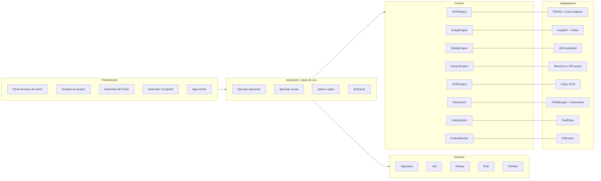

# Cabrio — contexto del proyecto

> Contexto completo del producto para construir **Cabrio** con Claude Code.
> Colócalo en la raíz del repositorio. Para que Claude Code lo tenga presente en cada sesión, pídele al iniciar que lea `cabrio.md`.
> Versión 1 · 10 de noviembre de 2026 · Responsable de producto: Federico Trujillo.

---

## 1. Qué es Cabrio

Cabrio es una app nativa de macOS que vive en la **barra de menú** y hace, **en el propio Mac y sin subir archivos a internet**, lo que hoy la gente hace en servicios web como iLovePDF o Smallpdf:

- unir, dividir, comprimir, proteger y hacer buscable (OCR) un PDF;
- convertir y comprimir imágenes, videos y audio;
- comprimir carpetas en un ZIP limpio y compatible con Windows;
- mantener ordenadas carpetas como Descargas y Escritorio con reglas automáticas.

**Cómo se usa:** el usuario arrastra archivos al ícono de la barra de menú (o los selecciona en Finder y usa el clic derecho, un atajo de teclado o una carpeta vigilada). Cabrio detecta el tipo de archivo, muestra solo las acciones que aplican, procesa todo en el equipo y guarda el resultado junto al original.

**Nombre:** Cabrio, por *cabriolet* (convertible). Se usa igual en español y en inglés. El símbolo es un cabriolet de perfil con la capota plegada.

### Público objetivo

1. Profesionales que manejan documentos todo el día: abogados, contadores, RR. HH., compras, administración.
2. Estudiantes y docentes que entregan trabajos en PDF.
3. Personas que hacen trámites en portales que exigen PDF por debajo de cierto tamaño.
4. Creadores y equipos de marketing que convierten y comprimen imágenes y video.

Mercado inicial: Colombia y Latinoamérica; luego España, Brasil y el resto del mundo.

### Propuesta de valor

| Herramientas web | Cabrio |
| --- | --- |
| Hay que subir cédulas, contratos y extractos a un servidor externo | Todo se procesa en el Mac; nada sale del equipo |
| Subir, esperar y descargar | Resultado en segundos, junto al original |
| Límites de tamaño, de tareas y anuncios | Sin límites de tamaño |
| Requiere internet | Funciona sin conexión |
| Una pestaña por herramienta | Un solo punto de entrada para todo |
| Interfaz traducida | Diseñada en español, con inglés y portugués |

---

## 2. Principios no negociables

Estas reglas mandan sobre cualquier otra decisión de implementación.

1. **Local primero, siempre.** Ningún archivo del usuario, ni su contenido, ni sus nombres, sale del equipo. La app no hace llamadas de red para procesar archivos. La única red permitida es la verificación de licencia y la búsqueda de actualizaciones, y nunca lleva datos de archivos.
2. **Nunca destruir.** El resultado se guarda junto al original con un sufijo (`_cabrio`, configurable). El original solo se reemplaza si el usuario lo pide de forma explícita. Toda operación queda en el historial y se puede deshacer. Las reglas de carpetas nunca borran de forma permanente: como máximo mueven a la Papelera.
3. **Español primero.** El idioma base de la interfaz es español (es-419). Los textos se escriben en español, no se traducen desde el inglés. Inglés y portugués de Brasil son traducciones.
4. **Nativo y liviano.** Swift y SwiftUI, sin Electron ni web views para la interfaz. Arranque en menos de 1 segundo y consumo en reposo bajo.
5. **Sin licencias que contaminen.** No se incluye en el binario ningún componente GPL o AGPL (por ejemplo Ghostscript, MuPDF, Poppler) salvo que se compre su licencia comercial. Toda dependencia nueva se registra con su licencia en `THIRD_PARTY_LICENSES.md` antes de agregarla.
6. **Accesible.** Todo control es accesible con teclado y VoiceOver, con contraste mínimo de 4,5:1.
7. **Seguro.** Sandbox de la App Store, hardened runtime, firma y notarización; acceso a carpetas solo con permiso explícito (security-scoped bookmarks).

---

## 3. Alcance por fases

| Módulo | Función | Fase |
| --- | --- | --- |
| PDF | Unir, dividir, extraer, reordenar y rotar páginas | MVP |
| PDF | Comprimir por nivel (baja, media, alta) o por meta de tamaño ("menos de 2 MB") | MVP |
| PDF | Imágenes a PDF y PDF a imágenes | MVP |
| PDF | OCR: volver buscable un PDF escaneado (español, inglés, portugués) | MVP |
| PDF | Proteger con contraseña; quitar contraseña conocida | MVP |
| PDF | Marca de agua, numeración de páginas y firma visual (imagen) | MVP |
| PDF | Word, Excel y PowerPoint a PDF | Fase 2 |
| PDF | PDF a Word y PDF a Excel | Fase 2 |
| PDF | Comparar versiones; censurar datos sensibles | Fase 3 |
| Imagen | Convertir entre HEIC, JPG, PNG y WebP | MVP |
| Imagen | Redimensionar y comprimir por lotes | MVP |
| Imagen | Quitar fondo | MVP |
| Video | Comprimir y convertir a MP4 (H.264 o HEVC), con meta de tamaño | MVP |
| Audio | Extraer audio de un video; convertir a M4A (AAC) | MVP |
| Audio | Convertir a MP3 | Fase 2 |
| Compresión | ZIP limpio para Windows (sin metadatos de macOS, nombres normalizados) | MVP |
| Compresión | Abrir 7z y RAR; crear 7z | Fase 2 |
| Organización | Renombrar por lotes con plantillas | MVP |
| Organización | Reglas para carpetas vigiladas (mover por tipo o antigüedad, convertir, archivar) | MVP |
| Organización | Clasificar y renombrar con IA local según el contenido | Fase 2 |
| Ventanas | Guardar y restaurar disposiciones de ventanas por proyecto | Fase 3 |

**Fuera de alcance:** cuentas de usuario, almacenamiento en la nube, edición de texto dentro del PDF, colaboración y cualquier procesamiento en servidores.

---

## 4. Experiencia de usuario

### 4.1 Puntos de entrada

1. **Arrastrar al ícono** de la barra de menú: abre el panel con los archivos ya cargados.
2. **Clic derecho en Finder**: submenú "Cabrio" con las acciones del tipo seleccionado y las recetas favoritas (extensión de Finder o Acciones rápidas).
3. **Atajo de teclado global**: abre el panel con la selección actual de Finder. Las recetas favoritas tienen atajos propios (⌥⌘1, ⌥⌘2, ⌥⌘3 por defecto).
4. **Carpeta vigilada**: las reglas se aplican solas cuando llega un archivo.
5. **Atajos de Apple (App Intents)** y menú **Compartir**: para automatizaciones.

### 4.2 Pantallas (referencia: lienzo de mockups "Cabrio · Mockups")

1. **Panel de la barra de menú:** zona para soltar archivos, aviso "Todo se procesa en tu Mac", tres recetas favoritas con atajo, recientes con acción "Mostrar" y el interruptor de "Organizar Descargas".
2. **Acciones:** encabezado con el archivo (nombre, páginas, tamaño), cuadrícula de 6 acciones según el tipo, enlace "Más", panel de opciones de la acción elegida, resultado estimado y botones "Comprimir" (primario) y "Guardar como receta".
3. **Actividad:** tareas en curso con barra de progreso, tiempo restante y "Cancelar"; tarea terminada con antes y después, lista de archivos y botones "Mostrar en Finder" y "Deshacer".
4. **Bienvenida:** mensaje de privacidad, tres beneficios, configuración inicial (activar el clic derecho en Finder y permitir acceso a Descargas) y botón "Empezar".
5. **Clic derecho en Finder:** submenú con acciones agrupadas por tipo y recetas.
6. **Ajustes:** ventana con General, Recetas, Reglas de carpetas, Formatos y calidad, Atajos de teclado y Licencia. Reglas en tabla "Cuando · Hacer · Activa", carpetas vigiladas, última ejecución e historial con deshacer.
7. **Marca:** logo, ícono de app, ícono de barra de menú, colores y tipografía.

### 4.3 Acciones que el panel ofrece según el tipo

| Tipo detectado | Acciones principales (en este orden) |
| --- | --- |
| 1 PDF | Comprimir, Dividir, Hacer buscable, Proteger, A imágenes, Marca de agua |
| Varios PDF | Unir, Comprimir todos, Hacer buscables, Proteger todos |
| Imágenes | Convertir formato, Comprimir, Redimensionar, Quitar fondo, Unir en un PDF |
| Video | Comprimir, Convertir a MP4, Extraer audio |
| Audio | Convertir a M4A, Comprimir |
| Carpeta o mezcla | ZIP limpio para Windows, Renombrar por lotes, Ordenar por tipo |
| Documento de Office (Fase 2) | Convertir a PDF |

### 4.4 Recetas

Una receta es una secuencia de operaciones con parámetros guardados, ejecutable en un clic o con atajo. Recetas por defecto:

- **Comprimir PDF para trámite:** compresión por meta de tamaño, 2 MB.
- **Fotos para web:** WebP, lado mayor 1.600 px, calidad 80.
- **Video liviano para compartir:** MP4, H.264, 1080p, bitrate ajustado.
- **ZIP limpio para Windows.**

### 4.5 Estados y mensajes

- **Vacío:** zona para soltar archivos y recetas.
- **Progreso:** porcentaje, tiempo restante estimado y cancelar; el ícono de la barra de menú muestra un indicador de progreso.
- **Éxito:** notificación del sistema con "Mostrar en Finder".
- **Error:** mensaje en español claro con causa y acción ("Este PDF tiene contraseña. Escríbela para continuar."). Nunca mostrar trazas técnicas al usuario.
- **Meta de tamaño imposible:** informar el mínimo alcanzado y ofrecer guardar igual o cambiar la meta.

---

## 5. Marca

- **Nombre en interfaz y textos:** "Cabrio" (en el logo va en minúsculas: "cabrio").
- **Símbolo:** cabriolet de perfil con capota plegada. Archivos en `Resources/Brand/` (kit `cabrio-kit-marca.zip`).
- **Ícono de app:** fondo negro `#111111`, símbolo blanco; PNG 1024 para el AppIcon de Xcode.
- **Ícono de barra de menú:** `cabrio-barra-menu-template.svg` (o PNG 18 y 36 px) cargado como **Template Image** para que macOS lo tiña según el tema.

| Token | Valor | Uso |
| --- | --- | --- |
| `ink` | `#111111` | Texto principal, botones primarios, ícono |
| `ink-secondary` | `#4A4A4A` | Texto secundario |
| `ink-tertiary` | `#5C5C5C` | Etiquetas y metadatos |
| `border` | `#E6E6E6` | Bordes y divisores |
| `surface` | `#FAFAFA` | Superficies secundarias |
| `background` | `#FFFFFF` | Fondo |
| Radio | 10 px controles, 14 px paneles | |
| Espaciado | Múltiplos de 4 (8, 12, 16, 20, 24) | |

Tipografía: Inter en materiales de marca; en la app, la fuente del sistema (SF Pro) para integrarse con macOS. Modo oscuro: invertir `ink` y `background` usando colores semánticos del sistema donde aplique.

---

## 6. Arquitectura

### 6.1 Decisiones técnicas

| Tema | Decisión |
| --- | --- |
| Lenguaje | Swift 6 con concurrencia estricta |
| Interfaz | SwiftUI (`MenuBarExtra` con estilo ventana) y AppKit donde haga falta (arrastrar al ícono, `NSStatusItem`) |
| Versión mínima | macOS 14 Sonoma (necesaria para quitar fondo con Vision); validar si se puede bajar |
| Arquitectura | Hexagonal (puertos y adaptadores) con Clean Architecture; DDD ligero en el dominio de operaciones |
| Persistencia | SwiftData para historial, recetas y reglas |
| Concurrencia | Cola de trabajos como `actor`, tareas cancelables, progreso con `AsyncStream` |
| Extensiones | Finder Sync o Acciones rápidas, extensión de Compartir, App Intents para Atajos |
| Actualizaciones | Sparkle en la versión de venta directa; App Store en la otra |
| Registro | `os.Logger` por subsistema; exportar diagnóstico local sin datos de archivos |

### 6.2 Capas



**Regla de dependencias:** el dominio no importa frameworks de Apple de procesamiento; los casos de uso solo conocen puertos (protocolos); los adaptadores implementan los puertos y son los únicos que importan PDFKit, Vision, ImageIO o AVFoundation. Esto permite cambiar un motor (por ejemplo, un SDK comercial de conversión a Word en Fase 2) sin tocar el resto.

### 6.3 Modelo de dominio

```swift
enum FileKind { case pdf, image, video, audio, officeDocument, archive, folder, other }

struct FileItem: Identifiable, Sendable {
    let id: UUID
    let url: URL
    let kind: FileKind
    let byteSize: Int64
    let pageCount: Int?          // PDF
    let pixelSize: CGSize?       // imagen
    let duration: Duration?      // video y audio
}

enum Operation: Sendable, Codable, Hashable {
    // PDF
    case mergePDFs
    case splitPDF(ranges: [ClosedRange<Int>])
    case compressPDF(CompressionTarget)
    case ocr(languages: [String])
    case protect(password: SecretRef)      // la contraseña nunca se persiste en texto plano
    case watermark(WatermarkSpec)
    case numberPages(NumberingSpec)
    case imagesToPDF, pdfToImages(format: ImageFormat, dpi: Int)
    // Imagen
    case convertImage(to: ImageFormat, quality: Double)
    case resizeImage(maxSide: Int)
    case removeBackground
    // Video y audio
    case compressVideo(VideoTarget)
    case extractAudio(format: AudioFormat)
    // Compresión y organización
    case cleanZip(name: String)
    case batchRename(template: RenameTemplate)
    case move(to: URL)
}

enum CompressionTarget: Sendable, Codable, Hashable {
    case level(Level)                // .low, .medium, .high
    case maxBytes(Int64)             // meta de tamaño
}

struct Recipe: Identifiable, Codable { let id: UUID; var name: String; var steps: [Operation]; var shortcut: KeyCombo? }

struct Rule: Identifiable, Codable {
    let id: UUID
    var folder: BookmarkRef
    var condition: RuleCondition     // tipo, extensión, antigüedad, nombre contiene...
    var actions: [Operation]
    var isEnabled: Bool
}

struct Job: Identifiable, Sendable {
    let id: UUID
    let inputs: [FileItem]
    let operations: [Operation]
    var state: JobState              // .queued, .running(progress), .succeeded(outputs), .failed(CabrioError), .cancelled
}
```

### 6.4 Puertos (protocolos)

```swift
protocol PDFEngine: Sendable {
    func merge(_ inputs: [URL], into output: URL) async throws
    func split(_ input: URL, ranges: [ClosedRange<Int>], outputDir: URL) async throws -> [URL]
    func compress(_ input: URL, target: CompressionTarget, output: URL,
                  progress: @Sendable (Double) -> Void) async throws -> CompressionReport
    func protect(_ input: URL, password: String, output: URL) async throws
    func watermark(_ input: URL, spec: WatermarkSpec, output: URL) async throws
    func numberPages(_ input: URL, spec: NumberingSpec, output: URL) async throws
    func render(_ input: URL, format: ImageFormat, dpi: Int, outputDir: URL) async throws -> [URL]
    func makePDF(fromImages images: [URL], output: URL) async throws
}
protocol OCREngine: Sendable { func makeSearchable(_ input: URL, languages: [String], output: URL,
                                                   progress: @Sendable (Double) -> Void) async throws }
protocol ImageEngine: Sendable { /* convert, resize, compress, removeBackground */ }
protocol MediaEngine: Sendable { /* compressVideo, extractAudio, estimateSize */ }
protocol ArchiveEngine: Sendable { func cleanZip(_ inputs: [URL], output: URL) async throws }
protocol FileSystem: Sendable { /* outputURL(for:suffix:), moveToTrash, bookmarks */ }
protocol HistoryStore: Sendable { /* record(job), undo(jobID) */ }
protocol FolderWatcher: Sendable { func events(for folder: URL) -> AsyncStream<URL> }
```

---

## 7. Motores y licencias

Verificar cada licencia antes de integrar. Regla: si es GPL o AGPL, no entra al binario sin licencia comercial.

| Función | Motor recomendado | Licencia | Nota |
| --- | --- | --- | --- |
| Unir, dividir, rotar, reordenar, marca de agua, numerar, proteger | PDFKit + Core Graphics (Apple) | Del sistema | Contraseña con las opciones de escritura de `PDFDocument` |
| Comprimir PDF | Re-muestreo de imágenes con Core Graphics; qpdf para optimizar estructura | Apple / Apache-2.0 (qpdf) | Evitar Ghostscript (AGPL) salvo licencia comercial de Artifex |
| OCR | Vision (`VNRecognizeTextRequest`) | Del sistema | Español, inglés y portugués; capa de texto invisible |
| Imágenes | ImageIO + Core Image | Del sistema | Codificación WebP: verificar soporte en ImageIO; si no, libwebp (BSD) |
| Quitar fondo | Vision (máscara de primer plano) | Del sistema | Requiere macOS 14 |
| Video y audio | AVFoundation (`AVAssetWriter`, `AVAssetExportSession`) | Del sistema | Evitar ffmpeg; si se usa, solo build LGPL enlazado dinámicamente |
| MP3 (Fase 2) | LAME | LGPL | Enlace dinámico y aviso de licencia |
| ZIP | Implementación propia o libarchive | BSD | Excluir metadatos; nombres en NFC; marca UTF-8 |
| 7z y RAR (Fase 2) | libarchive para lectura | BSD | La extracción RAR tiene restricciones de licencia; verificar |
| Office a PDF (Fase 2) | LibreOffice sin interfaz o SDK comercial | MPL-2.0 / comercial | LibreOffice pesa cientos de MB: evaluar descarga opcional |
| PDF a Word o Excel (Fase 2) | SDK comercial (por ejemplo Nutrient o Apryse) | Comercial | Decisión de costo pendiente |
| IA local para clasificar (Fase 2) | Apple Foundation Models o MLX | Del sistema / MIT | Sin nube |

### 7.1 Algoritmos clave

**Compresión de PDF por meta de tamaño**

1. Analizar el documento: peso de imágenes frente a texto y vectores.
2. Si las imágenes pesan poco, optimizar estructura (qpdf: object streams, eliminar duplicados) y terminar.
3. Si no, re-renderizar las imágenes embebidas a un DPI objetivo (300, 200, 150, 110, 96) y calidad JPEG (0,8 a 0,4).
4. Con meta de tamaño: búsqueda binaria sobre la combinación DPI y calidad hasta quedar bajo la meta con el mejor resultado visual; máximo 6 iteraciones.
5. Preservar texto como texto, hipervínculos y metadatos básicos. Nunca rasterizar páginas de texto, salvo que el usuario elija "máxima compresión".
6. Devolver `CompressionReport` con tamaño antes y después, y si se alcanzó la meta.

**OCR:** renderizar cada página a 300 DPI, reconocer con Vision en los idiomas elegidos y dibujar el texto invisible sobre la página original, conservando la imagen intacta.

**ZIP limpio para Windows:** excluir `.DS_Store`, `__MACOSX`, `._*`, `.Spotlight-V100`, `.Trashes`; normalizar nombres a Unicode NFC; activar la marca UTF-8 del ZIP; conservar estructura de carpetas.

**Video con meta de tamaño:** bitrate = (meta en bits × 0,95 − bitrate de audio × duración) ÷ duración; usar HEVC si el usuario lo permite, H.264 por compatibilidad por defecto.

**Nombre de salida:** `<nombre>_cabrio.<ext>`; si existe, agregar `-2`, `-3`. Configurable en Ajustes.

---

## 8. Seguridad y privacidad

- Sandbox activo en ambas versiones. Acceso a archivos por arrastre, selección del usuario o bookmarks con alcance de seguridad guardados al dar permiso a una carpeta.
- Sin derecho de red en la versión App Store salvo lo necesario para la licencia; nunca se envían nombres ni contenido de archivos.
- Contraseñas de PDF: solo en memoria durante la operación; si el usuario decide guardarlas en una receta, van al llavero (Keychain), nunca a SwiftData.
- Hardened runtime, firma Developer ID y notarización en la versión de venta directa.
- Sin telemetría por defecto. Si se agrega en el futuro: anónima, opcional y sin datos de archivos.
- Archivos temporales en el directorio temporal del contenedor; borrarlos al terminar o al cancelar.

---

## 9. Estructura del repositorio

```
Cabrio/
├── cabrio.md                 # Este documento
├── THIRD_PARTY_LICENSES.md
├── Cabrio.xcodeproj
├── App/                       # Punto de entrada, MenuBarExtra, AppDelegate, inyección de dependencias
├── Presentation/
│   ├── MenuBarPanel/          # Panel, zona de arrastre, acciones, actividad
│   ├── Settings/              # General, Recetas, Reglas, Formatos, Atajos, Licencia
│   ├── Onboarding/
│   └── DesignSystem/          # Tokens de color, tipografía, componentes
├── Application/               # Casos de uso: RunOperation, RunRecipe, ApplyRules, Undo
├── Domain/                    # Entidades, value objects, errores (CabrioError)
├── Ports/                     # Protocolos de motores, almacenamiento y sistema de archivos
├── Adapters/
│   ├── PDF/                   # PDFKit, Core Graphics, qpdf
│   ├── OCR/                   # Vision
│   ├── Image/                 # ImageIO, Core Image, Vision
│   ├── Media/                 # AVFoundation
│   ├── Archive/
│   ├── FileSystem/
│   └── Persistence/           # SwiftData
├── Extensions/
│   ├── FinderExtension/
│   ├── ShareExtension/
│   └── Intents/               # App Intents para Atajos
├── Resources/
│   ├── Brand/                 # Kit de marca
│   └── Localizable.xcstrings  # es-419 base, en, pt-BR
└── Tests/
    ├── DomainTests/
    ├── ApplicationTests/
    ├── AdapterTests/          # Con archivos de prueba en Fixtures/
    ├── UITests/
    └── Fixtures/              # PDF escaneados, PDF con contraseña, HEIC, MOV, nombres con tildes y ñ
```

---

## 10. Pruebas y calidad

- **Dominio y aplicación:** pruebas unitarias con motores falsos (dobles de los puertos).
- **Adaptadores:** pruebas de integración con archivos reales de `Tests/Fixtures`:
  - PDF de 1, 50 y 300 páginas; escaneado; con contraseña; con formularios; dañado.
  - Imágenes HEIC, PNG con transparencia, JPG de 48 MP.
  - Video MOV de iPhone, MP4, archivo sin audio.
  - Carpetas con nombres que tienen tildes, ñ y emojis.
- **Compresión:** verificar que el texto sigue seleccionable y que la meta de tamaño se cumple o se informa.
- **ZIP limpio:** descomprimir en un entorno Windows de prueba y verificar nombres y ausencia de metadatos.
- **Rendimiento (metas a validar):** abrir el panel en menos de 200 ms; comprimir un PDF de 50 páginas escaneadas en segundos en Apple Silicon; no bloquear el hilo principal nunca.
- **Accesibilidad:** navegación completa con teclado y VoiceOver en el panel y en Ajustes.
- **Localización:** capturas de pantalla en es-419, en y pt-BR sin textos cortados.
- CI: compilar, pruebas, SwiftLint y SwiftFormat en cada pull request.

---

## 11. Distribución y negocio

- **Venta directa:** app notarizada con Sparkle, licencias con un *merchant of record* (Paddle o Lemon Squeezy, decisión pendiente) y un proveedor de respaldo.
- **Mac App Store:** versión con sandbox; compra dentro de la app para Pro.
- **Modelo:** periodo de prueba (tester) gratuito de 90 días por persona, contados desde la primera vez que abre la app (0.10.1; en 0.10.0 era una fecha fija); después, 10 USD por app, pago único, con clave de licencia verificada sin conexión.
- **Licencia en la app:** clave firmada (ECDSA P-256) verificada sin conexión; ver `Sources/CabrioDomain/Licensing.swift`.

---

## 12. Criterios de aceptación del MVP

1. Arrastrar un PDF al ícono muestra sus acciones en menos de 200 ms.
2. Comprimir un PDF con meta de 2 MB entrega un archivo de 2 MB o menos con texto seleccionable, o informa el mínimo alcanzado.
3. Unir 10 PDF respeta el orden elegido por el usuario.
4. Un PDF escaneado queda buscable en español tras el OCR.
5. Convertir 50 fotos HEIC a WebP o JPG funciona en lote, con progreso y cancelación.
6. Un ZIP limpio abre en Windows con nombres correctos y sin `__MACOSX` ni `.DS_Store`.
7. Una regla en Descargas mueve capturas a su carpeta sin intervención y se puede deshacer.
8. Ninguna operación hace llamadas de red (verificado con un monitor de red durante las pruebas).
9. Toda la interfaz está en español, inglés y portugués.
10. La app pasa notarización y la revisión de la Mac App Store.

---

## 13. Backlog inicial

**Épica 1 — Base**
- Proyecto Xcode con módulos por capa, inyección de dependencias y design system.
- `MenuBarExtra` con ícono de plantilla y panel vacío.
- Zona de arrastre y detección de tipo (`UTType`).
- Cola de trabajos (`actor`), progreso y cancelación.
- Historial en SwiftData y "Deshacer".

**Épica 2 — PDF**
- Unir, dividir, rotar, reordenar, extraer.
- Comprimir por nivel y por meta de tamaño.
- OCR con Vision.
- Proteger y quitar contraseña.
- Marca de agua, numeración y firma visual.

**Épica 3 — Imagen, video y audio**
- Convertir y comprimir imágenes por lotes.
- Quitar fondo.
- Comprimir video con meta de tamaño; extraer audio.

**Épica 4 — Organización**
- ZIP limpio para Windows.
- Renombrar por lotes con plantillas.
- Reglas de carpetas con FSEvents y bookmarks.

**Épica 5 — Integración con el sistema**
- Acciones en el clic derecho de Finder.
- Extensión de Compartir.
- App Intents para Atajos.
- Atajos de teclado globales y recetas.

**Épica 6 — Producto**
- Bienvenida y permisos.
- Ajustes completos.
- Licencias, actualizaciones y notarización.
- Localización es-419, en, pt-BR.

---

## 14. Decisiones pendientes

- [ ] Verificar la disponibilidad de la marca "Cabrio" (SIC, USPTO, EUIPO), dominio y nombre en la App Store.
- [ ] Versión mínima de macOS (14 propuesta).
- [ ] Proveedor de cobro principal y de respaldo.
- [ ] Precio de Pro y precio regional.
- [ ] Motor para Office ↔ PDF en Fase 2 (LibreOffice descargable frente a SDK comercial).
- [ ] Extensión de Finder (Finder Sync) frente a Acciones rápidas: validar qué permite la App Store para el submenú propuesto.

---

## 15. Cómo trabajar en este repositorio (instrucciones para Claude Code)

- Responde y documenta en **español**; nombres de tipos, funciones y variables en **inglés**.
- Respeta la regla de dependencias de la sección 6: nada de PDFKit, Vision, ImageIO o AVFoundation fuera de `Adapters/`.
- Antes de agregar una dependencia, revisa su licencia y regístrala en `THIRD_PARTY_LICENSES.md`. Si es GPL o AGPL, detente y pregunta.
- Toda operación nueva necesita: caso en `Operation`, método en el puerto, adaptador, pruebas con fixtures y textos en `Localizable.xcstrings`.
- Nunca escribas código que borre archivos de forma permanente; usa la Papelera.
- Nunca agregues llamadas de red relacionadas con archivos.
- Ejecuta las pruebas antes de dar una tarea por terminada.
- Mensajes de commit en español, en imperativo y cortos ("Agrega compresión de PDF por meta de tamaño").
- Si una decisión de la sección 14 bloquea el trabajo, propone opciones con pros y contras y pregunta antes de decidir.
